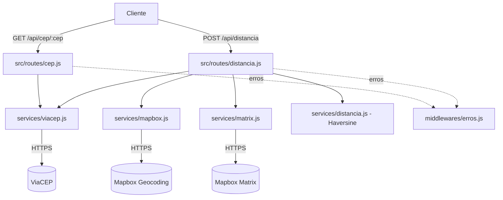

# Mss-CEP — Microserviço de CEP e distância

Microserviço em **Node.js + Express 5** que valida CEPs brasileiros pela **ViaCEP** e calcula a distância entre dois CEPs em **linha reta** (fórmula de Haversine) e, opcionalmente, **por rota** com duração estimada (**Mapbox Matrix API**).


---

## Índice

- [1. O que a API faz](#1-o-que-a-api-faz)
- [2. Stack](#2-stack)
- [3. Arquitetura](#3-arquitetura)
- [4. Instalação](#4-instalação)
- [5. Variáveis de ambiente](#5-variáveis-de-ambiente)
- [6. Como executar](#6-como-executar)
- [7. Endpoints](#7-endpoints)
- [8. Validações de entrada](#8-validações-de-entrada)
- [9. Códigos de erro](#9-códigos-de-erro)
- [10. Como as distâncias são calculadas](#10-como-as-distâncias-são-calculadas)
- [11. Limitações conhecidas](#11-limitações-conhecidas)
- [12. Testes manuais](#12-testes-manuais)
- [13. Responsabilidades por camada](#13-responsabilidades-por-camada)
- [14. Próximos passos](#14-próximos-passos)

---

## 1. O que a API faz

| Funcionalidade | Endpoint |
| --- | --- |
| Validar um CEP e devolver o endereço | `GET /api/cep/:cep` |
| Calcular distância em linha reta entre dois CEPs | `POST /api/distancia` |
| Calcular distância por rota e duração estimada | `POST /api/distancia` com `"calcularRota": true` |
| Verificar se o serviço está no ar | `GET /` |

---

## 2. Stack

| Pacote | Uso |
| --- | --- |
| `express` 5.x | Servidor HTTP e roteamento |
| `axios` | Cliente HTTP para ViaCEP e Mapbox |
| `cors` | Liberação de origem para consumo por front-end |
| `dotenv` | Leitura das variáveis de ambiente |
| `nodemon` (*dev*) | Reinício automático durante o desenvolvimento |

O projeto usa **ES Modules** (`"type": "module"` no `package.json`): todos os arquivos usam `import` / `export`.

---

## 3. Arquitetura

Separação em três camadas, com uma regra simples: **services e utils não conhecem HTTP** (não recebem `req`/`res`) e **rotas não conhecem as APIs externas**.



### 3.1. Estrutura de pastas

```
Mss-cep/
├── server.js                    # Bootstrap: middlewares, rotas, 404, tratador de erros, listen
├── package.json
├── .env                         # variáveis reais (NÃO versionado)
├── .env.example                 # modelo versionado, sem segredos
├── .gitignore
└── src/
    ├── middlewares/
    │   └── erros.js             # rota não encontrada (404) + tratador de erros central
    ├── routes/
    │   ├── cep.js               # GET /api/cep/:cep
    │   └── distancia.js         # POST /api/distancia
    ├── services/
    │   ├── viacep.js            # CEP -> endereço
    │   ├── mapbox.js            # endereço -> latitude/longitude
    │   ├── matrix.js            # coordenadas -> distância e duração de rota
    │   └── distancia.js         # Haversine (cálculo puro, sem rede)
    └── utils/
        ├── validarCep.js        # cepValido(cep)
        └── erroHttp.js          # erroHttp(statusCode, mensagem)
```

### 3.2. Fluxo do `POST /api/distancia`

1. Valida formato dos dois CEPs (`400` se inválido) — **antes** de qualquer chamada externa.
2. Consulta os dois CEPs na ViaCEP **em paralelo** (`Promise.all`).
3. Geocodifica os dois endereços na Mapbox **em paralelo**.
4. Calcula a distância em linha reta (Haversine, sem rede).
5. Se `calcularRota === true`, consulta a Matrix API e adiciona `distanciaRotaKm` e `duracaoEstimadaMin`.
6. Erros sobem para o middleware central, que responde JSON com o status adequado.

---

## 4. Instalação

```bash
git clone <url-do-repositorio>
cd Mss-cep
npm install
cp .env.example .env    # Windows: copy .env.example .env
```

Depois preencha `MAPBOX_TOKEN` no `.env` (veja a seção 5).

**Pré-requisitos:** Node.js 18 ou superior (o projeto usa ES Modules e o Express 5, que encaminha erros de handlers `async` automaticamente).

---

## 5. Variáveis de ambiente

O token da Mapbox **nunca** deve ser commitado.

`.env` (não versionado):

```env
PORT=3001
MAPBOX_TOKEN=seu_token_aqui
```

`.env.example` (versionado):

```env
PORT=3001
MAPBOX_TOKEN=
```

| Variável | Obrigatória | Descrição |
| --- | --- | --- |
| `PORT` | não | Porta HTTP. Padrão do código: `3000`. O `.env.example` sugere `3001` para não conflitar com outros projetos locais |
| `MAPBOX_TOKEN` | **sim** | Token de acesso da Mapbox, usado na geocodificação e na Matrix API |

> A ViaCEP não exige autenticação.

---

## 6. Como executar

```bash
npm run dev      # desenvolvimento, com reinício automático (nodemon)
npm start        # produção
```

Saída esperada no console:

```
🚀 Servidor rodando na porta 3001
```

> **Atenção:** a porta vem do `PORT` no `.env`. Confira a mensagem do console antes de testar — usar a porta errada gera `HTTP 000` (conexão recusada), que parece erro de código mas é apenas endereço incorreto.

---

## 7. Endpoints

### 7.1. `GET /` — health check

```json
{ "status": "ok", "mensagem": "Microserviço Mss-CEP operante!" }
```

### 7.2. `GET /api/cep/:cep` — validar um CEP

`cep` deve conter exatamente 8 dígitos (somente números; hífen e pontos não são aceitos).

```bash
curl http://localhost:3001/api/cep/01001000
```

`200 OK`

```json
{
  "cep": "01001-000",
  "logradouro": "Praça da Sé",
  "complemento": "lado ímpar",
  "bairro": "Sé",
  "localidade": "São Paulo",
  "uf": "SP"
}
```

A resposta traz **apenas os campos do contrato** — os dados extras da ViaCEP (`ibge`, `ddd`, `gia`, `siafi`, `regiao`) são descartados no service.

### 7.3. `POST /api/distancia` — distância entre dois CEPs

Corpo da requisição:

```json
{
  "cepOrigem": "01001000",
  "cepDestino": "01310930",
  "calcularRota": false
}
```

| Campo | Tipo | Obrigatório | Descrição |
| --- | --- | --- | --- |
| `cepOrigem` | string | sim | 8 dígitos |
| `cepDestino` | string | sim | 8 dígitos, diferente de `cepOrigem` |
| `calcularRota` | boolean | não | `true` adiciona distância por rota e duração estimada |

`200 OK` — apenas linha reta:

```json
{
  "cepOrigem": "01001000",
  "cepDestino": "01310930",
  "enderecoOrigem": {
    "cep": "01001-000",
    "logradouro": "Praça da Sé",
    "complemento": "lado ímpar",
    "bairro": "Sé",
    "localidade": "São Paulo",
    "uf": "SP"
  },
  "enderecoDestino": {
    "cep": "01310-930",
    "logradouro": "Avenida Paulista",
    "complemento": "2100",
    "bairro": "Bela Vista",
    "localidade": "São Paulo",
    "uf": "SP"
  },
  "distanciaLinhaRetaKm": 2.52
}
```

`200 OK` — com `"calcularRota": true`:

```json
{
  "distanciaLinhaRetaKm": 2.52,
  "distanciaRotaKm": 3.32,
  "duracaoEstimadaMin": 11
}
```

(Os demais campos de endereço continuam presentes; o trecho acima mostra só os numéricos.)

Exemplo de distância longa (São Paulo → Rio de Janeiro), útil como teste de sanidade — a rota deve ser **maior** que a linha reta:

```json
{
  "distanciaLinhaRetaKm": 360.52,
  "distanciaRotaKm": 443.91,
  "duracaoEstimadaMin": 368
}
```

---

## 8. Validações de entrada

| Regra | Falha |
| --- | --- |
| CEP com exatamente 8 dígitos | `400` |
| CEP enviado como **texto**, não número | `400` |
| `calcularRota`, se presente, precisa ser booleano | `400` |
| `cepOrigem` e `cepDestino` diferentes | `400` |
| Corpo ausente ou sem `Content-Type: application/json` | `400` |

CEP é **identificador**, não quantidade: enviado como número, `01310930` perde o zero à esquerda e chega como `1310930`. Por isso o tipo é validado.

---

## 9. Códigos de erro

Formato padrão de erro:

```json
{ "error": true, "mensagem": "CEP não encontrado." }
```

| Status | Significado | Quando acontece |
| --- | --- | --- |
| `400 Bad Request` | requisição inválida | formato de CEP, `calcularRota` não booleano, CEPs iguais, corpo ausente |
| `404 Not Found` | recurso inexistente | CEP não existe na base da ViaCEP; rota HTTP inexistente |
| `422 Unprocessable Entity` | requisição válida, conteúdo impossível | endereço existe no ViaCEP mas não foi localizado pelo geocodificador; Matrix sem rota entre os pontos |
| `502 Bad Gateway` | falha em serviço externo | ViaCEP ou Mapbox indisponível, resposta inesperada ou timeout (5 s) |
| `500 Internal Server Error` | erro inesperado no serviço | bug não previsto — a mensagem devolvida é genérica de propósito, para não expor detalhes internos |

Todas as chamadas externas têm **timeout de 5 segundos**; sem isso, uma API lenta deixaria a requisição pendurada indefinidamente.

---

## 10. Como as distâncias são calculadas

### 10.1. Linha reta — Haversine ([src/services/distancia.js](src/services/distancia.js))

```js
a = sin²(Δφ/2) + cos φ₁ · cos φ₂ · sin²(Δλ/2)
d = 2 · R · atan2(√a, √(1−a))
```

- `φ` são latitudes e `λ` longitudes, **convertidas para radianos**.
- `R = 6371 km` (raio médio da Terra) — é o que define a unidade do resultado.
- Resultado arredondado para 2 casas e convertido de string para número (`Number(x.toFixed(2))`).

Usa-se `atan2` em vez de `acos` porque a versão com `acos` pode receber `1.0000000000000002` por arredondamento de ponto flutuante e devolver `NaN` — justamente quando os dois pontos estão muito próximos. É a forma numericamente estável.

### 10.2. Rota e duração — Mapbox Matrix API ([src/services/matrix.js](src/services/matrix.js))

```
GET https://api.mapbox.com/directions-matrix/v1/mapbox/driving/{lon,lat};{lon,lat}
    ?annotations=distance,duration&access_token=...
```

- Coordenadas em **`longitude,latitude`** (nessa ordem).
- `durations` em **segundos**, `distances` em **metros** — o service converte para km e minutos.
- `distances[0][1]` é o trajeto origem → destino.
- Sem rota possível, o elemento vem `null` e a API responde `422`.
- Perfil usado: **`mapbox/driving`** (carro).

---

## 11. Limitações conhecidas

1. **Não há perfil de moto.** A Mapbox oferece apenas `driving`, `driving-traffic`, `walking` e `cycling`. Para moto, o resultado disponível é o de carro (`driving`), sem estimativa específica.
2. **CEP só é aceito com 8 dígitos**, sem máscara (`01001-000` é rejeitado com `400`).
3. **Geocodificação aproximada.** A Mapbox recebe `logradouro, bairro, cidade - UF, Brasil`. Sem número do imóvel, as coordenadas são do trecho do logradouro — distâncias curtas podem variar dezenas de metros.
4. **CEPs de município inteiro** (sem logradouro) não são geocodificáveis por esse método e resultam em `422`.
5. **Sem autenticação, rate limit ou cache** nesta versão — adequado para estudo e uso interno, não para exposição pública.
6. **Dependência de duas APIs de terceiros**, com cotas próprias. A chave usada é o token **público** da Mapbox, restrito por URL quando configurado no painel da Mapbox.

---

## 12. Testes manuais

Com o servidor no ar (ajuste a porta conforme o seu `.env`):

```powershell
# 1 CEP válido
curl.exe -s -w '\nHTTP %{http_code}\n' http://localhost:3001/api/cep/01001000

# CEP inexistente -> 404
curl.exe -s -w '\nHTTP %{http_code}\n' http://localhost:3001/api/cep/99999999

# Formato inválido -> 400
curl.exe -s -w '\nHTTP %{http_code}\n' http://localhost:3001/api/cep/123

# Rota inexistente -> 404 em JSON
curl.exe -s -w '\nHTTP %{http_code}\n' http://localhost:3001/api/rota-que-nao-existe
```

```powershell
$body = @{ cepOrigem = '01001000'; cepDestino = '01310930'; calcularRota = $true } | ConvertTo-Json
Invoke-RestMethod -Uri http://localhost:3001/api/distancia -Method Post -ContentType 'application/json' -Body $body | ConvertTo-Json -Depth 5
```

---

## 13. Responsabilidades por camada

| Camada | Responsabilidade | Conhece `req`/`res`? | Conhece APIs externas? |
| --- | --- | --- | --- |
| `routes/` | Ler entrada, validar, chamar services, escolher status HTTP | sim | não |
| `services/` | Integrações externas e cálculos; **lança** erros com `statusCode` | não | sim |
| `utils/` | Funções puras reutilizáveis | não | não |
| `middlewares/` | Traduzir erro em resposta JSON padronizada; 404 | sim | não |

Consequências práticas dessa separação:

- trocar a ViaCEP por outro provedor exige mudar **um** arquivo;
- qualquer rota pode reutilizar `buscarEndereco` (o `POST` chama duas vezes por requisição);
- services podem ser testados com `node -e` ou testes unitários, sem subir servidor.

---

## 14. Próximos passos

Itens **não** implementados nesta versão, em ordem sugerida:

1. Testes automatizados com o runner nativo (`node --test`) para `calcularDistanciaLinhaReta`, `cepValido` e as rotas.
2. Cache de CEPs e de coordenadas (dados de endereço mudam pouco) para reduzir latência e consumo de cota.
3. Rate limiting e autenticação por API key antes de expor o serviço publicamente.
4. Normalização de CEP com máscara (`01001-000` → `01001000`).
5. Fallback de geocodificação quando o logradouro não for encontrado (ex.: geocodificar apenas `localidade/uf`).
