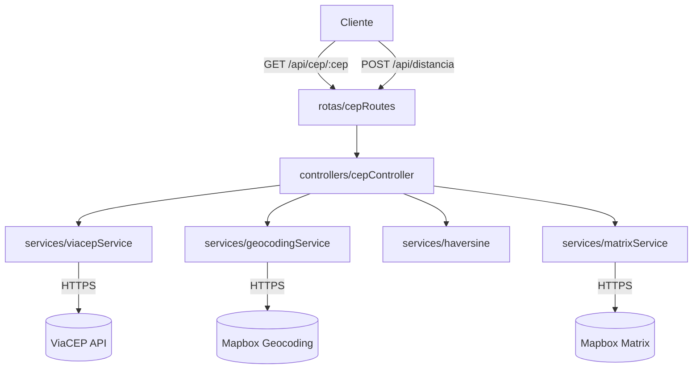

# Mss-CEP — Microserviço de Consulta e Distância entre CEPs

Microserviço em **Node.js** que consulta, valida e calcula distâncias entre CEPs brasileiros, integrando a **ViaCEP** (dados de endereço) e a **Mapbox** (geocodificação e rotas).


---

## Índice

- [1. Objetivo do projeto](#1-objetivo-do-projeto)
- [2. Stack e dependências](#2-stack-e-dependências)
- [3. Arquitetura](#3-arquitetura)
- [4. Instalação](#4-instalação)
- [5. Variáveis de ambiente](#5-variáveis-de-ambiente)
- [6. Como executar](#6-como-executar)
- [7. Endpoints da aplicação](#7-endpoints-da-aplicação)
- [8. Modos de utilização](#8-modos-de-utilização)
- [9. Cálculo de distância (Haversine)](#9-cálculo-de-distância-haversine)
- [10. Integração com a Mapbox](#10-integração-com-a-mapbox)
- [11. Tratamento de erros](#11-tratamento-de-erros)
- [12. Plano de implementação](#12-plano-de-implementação)
- [13. Testes](#13-testes)
- [14. Boas práticas adotadas](#14-boas-práticas-adotadas)

---

## 1. Objetivo do projeto

Desenvolver um microserviço em Node.js capaz de consultar, validar e calcular distâncias entre CEPs brasileiros, utilizando APIs externas.

O sistema trabalha com duas integrações principais:

| API | Finalidade |
| --- | --- |
| **ViaCEP** | Consulta de informações de endereços brasileiros |
| **Mapbox** | Geocodificação e cálculo de distância/tempo de deslocamento |

O projeto permite:

- Consultar **um único CEP** e obter os dados do endereço;
- Informar **dois CEPs** e receber os dados dos endereços, a distância em linha reta (Haversine) e, opcionalmente, a distância por rota e o tempo estimado.

---

## 2. Stack e dependências

| Pacote | Versão | Uso |
| --- | --- | --- |
| `express` | ^5.3.0 | Servidor HTTP e roteamento |
| `axios` | ^1.21.0 | Cliente HTTP para ViaCEP e Mapbox |
| `cors` | ^2.8.6 | Liberação de origem para consumo do front-end |
| `dotenv` | ^18.0.9 | Leitura das variáveis de ambiente |
| `nodemon` | ^3.1.14 | *dev* — reload automático |

O projeto usa **ES Modules** (`"type": "module"` no `package.json`), portanto todos os arquivos utilizam `import` / `export`.

---

## 3. Arquitetura

Separação de responsabilidades entre **rotas**, **controladores** e **serviços**:



### 3.1. Estrutura de pastas

```
Mss-cep/
├── server.js                    # Bootstrap: middlewares, rotas e listen
├── package.json
├── .env                         # credenciais reais (NÃO versionar)
├── .env.example                 # modelo de variáveis
├── .gitignore
└── src/
    ├── routes/
    │   └── cepRoutes.js         # definição das rotas /api
    ├── controllers/
    │   └── cepController.js     # orquestração das requisições
    ├── services/
    │   ├── viacepService.js     # consulta de endereço
    │   ├── geocodingService.js  # endereço -> lat/lon
    │   ├── matrixService.js     # distância/duração por rota
    │   └── haversine.js         # distância em linha reta
    └── utils/
        ├── validarCep.js        # validação/normalização do CEP
        └── httpError.js         # erro padronizado com statusCode
```

### 3.2. Responsabilidades

- **Rotas:** apenas mapeiam método + caminho para um controlador.
- **Controladores:** validam entrada, chamam serviços e montam a resposta JSON.
- **Serviços:** concentram integrações externas e cálculos puros, sem conhecer `req`/`res`.
- **Utils:** funções reutilizáveis (validação de CEP, classe de erro HTTP).

---

## 4. Instalação

```bash
# 1. Clone o repositório
git clone <url-do-repositorio>
cd Mss-cep

# 2. Instale as dependências
npm install

# 3. Crie o arquivo de variáveis de ambiente
cp .env.example .env    # Windows: copy .env.example .env

# 4. Preencha o MAPBOX_ACCESS_TOKEN no .env
```

**Pré-requisitos:** Node.js 18 ou superior (suporte nativo a `fetch` e ao `--watch`).

---

## 5. Variáveis de ambiente

A chave da Mapbox **nunca** deve ficar no código-fonte.

`.env`

```env
PORT=3000
MAPBOX_ACCESS_TOKEN=SEU_TOKEN_AQUI
```

`.env.example` (versionado, sem segredo real)

```env
PORT=3000
MAPBOX_ACCESS_TOKEN=
```

`.gitignore`

```gitignore
node_modules/
.env
```

> ⚠️ O arquivo `.env` já está listado no `.gitignore`. Nunca comite tokens — se um token vazar, revogue-o no painel da Mapbox e gere outro.

---

## 6. Como executar

```bash
# desenvolvimento (reload automático)
npm run dev

# produção
node server.js
```

Saída esperada:

```
🚀 Servidor rodando na porta 3000
```

Health check:

```bash
curl http://localhost:3000/
```

```json
{
  "status": "ok",
  "mensagem": "Microserviço Mss-CEP operante!"
}
```

---

## 7. Endpoints da aplicação

### 7.1. Consultar e validar um CEP

**Método:** `GET`
**Rota:** `/api/cep/:cep`

| Parâmetro | Tipo | Descrição |
| --- | --- | --- |
| `cep` | path | 8 dígitos, com ou sem hífen |

**Requisição**

```bash
curl http://localhost:3000/api/cep/01001000
```

**Resposta — `200 OK`**

```json
{
  "cep": "01001-000",
  "logradouro": "Praça da Sé",
  "complemento": "lado ímpar",
  "bairro": "Sé",
  "localidade": "São Paulo",
  "uf": "SP"
}
```

**Resposta — `404 Not Found`**

```json
{
  "erro": true,
  "mensagem": "CEP não encontrado."
}
```

---

### 7.2. Calcular distância entre dois CEPs

**Método:** `POST`
**Rota:** `/api/distancia`

**Corpo da requisição**

| Campo | Tipo | Obrigatório | Descrição |
| --- | --- | --- | --- |
| `cepOrigem` | string | sim | CEP de origem (8 dígitos) |
| `cepDestino` | string | sim | CEP de destino (8 dígitos) |
| `calcularRota` | boolean | não | Se `true`, consulta a Mapbox Matrix API |

```json
{
  "cepOrigem": "01001000",
  "cepDestino": "01310930",
  "calcularRota": true
}
```

**Fluxo executado**

1. Valida os dois CEPs;
2. Consulta os endereços na ViaCEP;
3. Obtém as coordenadas geográficas dos endereços;
4. Calcula a distância em linha reta (Haversine);
5. Se `calcularRota` for `true`, consulta a Mapbox Matrix API;
6. Retorna os dois endereços e os resultados dos cálculos.

**Resposta — `200 OK`**

```json
{
  "cepOrigem": "01001000",
  "cepDestino": "01310930",
  "enderecoOrigem": {
    "cep": "01001-000",
    "logradouro": "Praça da Sé",
    "complemento": "lado ímpar",
    "bairro": "Sé",
    "localidade": "São Paulo",
    "uf": "SP"
  },
  "enderecoDestino": {
    "cep": "01310-930",
    "logradouro": "Avenida Paulista",
    "complemento": "2100",
    "bairro": "Bela Vista",
    "localidade": "São Paulo",
    "uf": "SP"
  },
  "distanciaLinhaRetaKm": 2.52,
  "distanciaRotaKm": 3.32,
  "duracaoEstimadaMin": 11
}
```

> Os valores de distância e duração acima são **ilustrativos**.
> Quando `calcularRota` for `false` (ou omitido), `distanciaRotaKm` e `duracaoEstimadaMin` retornam `null`.

---

## 8. Modos de utilização

### Modo 1 — Apenas um CEP

Quando o usuário informar apenas um CEP, o sistema realiza a consulta na ViaCEP e retorna os dados do endereço.

```bash
curl http://localhost:3000/api/cep/01310930
```

### Modo 2 — Dois CEPs

Quando o usuário informar dois CEPs, o sistema:

- Valida os dois CEPs;
- Consulta os dois endereços;
- Obtém as coordenadas geográficas;
- Calcula a distância em linha reta;
- Calcula a distância por rota caso `calcularRota` esteja habilitado.

---

## 9. Cálculo de distância (Haversine)

A distância em linha reta é calculada nativamente em Node.js, sem dependências externas, usando a **fórmula de Haversine** — que considera a curvatura da Terra (modelo esférico).

$$
d = 2R \cdot \arcsin\left(\sqrt{\sin^2\!\left(\frac{\Delta\varphi}{2}\right) + \cos\varphi_1 \cdot \cos\varphi_2 \cdot \sin^2\!\left(\frac{\Delta\lambda}{2}\right)}\right)
$$

Onde:

| Símbolo | Significado |
| --- | --- |
| $\varphi_1, \varphi_2$ | Latitudes dos pontos 1 e 2 (em radianos) |
| $\Delta\varphi$ | Diferença de latitude |
| $\Delta\lambda$ | Diferença de longitude |
| $R$ | Raio da Terra (≈ 6.371 km) |

O resultado é arredondado para **2 casas decimais**, expresso em quilômetros.

```js
// src/services/haversine.js
const RAIO_TERRA_KM = 6371;

const toRad = (graus) => (graus * Math.PI) / 180;

export function calcularDistanciaHaversine(pontoA, pontoB) {
  const dLat = toRad(pontoB.lat - pontoA.lat);
  const dLon = toRad(pontoB.lon - pontoA.lon);
  const lat1 = toRad(pontoA.lat);
  const lat2 = toRad(pontoB.lat);

  const a =
    Math.sin(dLat / 2) ** 2 +
    Math.cos(lat1) * Math.cos(lat2) * Math.sin(dLon / 2) ** 2;

  const c = 2 * Math.asin(Math.sqrt(a));

  return Number((RAIO_TERRA_KM * c).toFixed(2));
}
```

---

## 10. Integração com a Mapbox

### 10.1. Geocoding API

Converte o endereço retornado pela ViaCEP em **latitude/longitude**:

```
GET https://api.mapbox.com/geocoding/v5/mapbox.places/{endereco}.json
    ?access_token=TOKEN
    &country=br
    &limit=1
```

O endereço é montado a partir dos campos da ViaCEP, por exemplo:
`Praça da Sé, Sé, São Paulo, SP, 01001-000, Brasil`

### 10.2. Matrix API

Calcula a distância e a duração entre as coordenadas obtidas:

```
GET https://api.mapbox.com/directions-matrix/v1/mapbox/driving/{lon1},{lat1};{lon2},{lat2}
    ?access_token=TOKEN
    &annotations=distance,duration
```

> ⚠️ A Matrix API recebe sempre **longitude,latitude** (nessa ordem).

**Regras do projeto**

- Perfil padrão: `mapbox/driving` — deslocamento **de carro**.
- O resultado **não** representa uma rota específica para motocicletas.
- A integração é **opcional**, controlada pela propriedade `calcularRota`.
- Conversões aplicadas na resposta:
  - `distance` (metros) → `distanciaRotaKm` (km, 2 casas decimais);
  - `duration` (segundos) → `duracaoEstimadaMin` (minutos, arredondado).

---

## 11. Tratamento de erros

Todas as respostas de erro seguem o mesmo formato JSON:

```json
{
  "erro": true,
  "mensagem": "Descrição legível do problema."
}
```

| Situação | HTTP | Mensagem |
| --- | --- | --- |
| CEP com formato inválido | `400` | "CEP inválido. Informe 8 dígitos." |
| Dados obrigatórios não informados | `400` | "Informe cepOrigem e cepDestino." |
| CEP não encontrado na ViaCEP | `404` | "CEP não encontrado." |
| CEP de origem ou destino inexistente | `404` | "CEP de origem não encontrado." |
| Endereço sem coordenadas disponíveis | `422` | "Não foi possível obter as coordenadas do endereço." |
| Impossibilidade de encontrar rota | `422` | "Não foi possível calcular a rota entre os pontos." |
| Token da Mapbox ausente ou inválido | `500` / `502` | "Token da Mapbox ausente ou inválido." |
| Falha na comunicação com a ViaCEP | `502` | "Serviço ViaCEP indisponível." |
| Falha na comunicação com a Mapbox | `502` | "Serviço Mapbox indisponível." |
| Erro inesperado | `500` | "Erro interno no servidor." |

**Diretrizes**

- Erros previstos usam uma classe `HttpError` com `statusCode` + `mensagem`;
- Um middleware final captura tudo e padroniza a resposta;
- Nunca retornar *stack trace* ou detalhes internos ao cliente;
- Logs internos (`console.error`) preservam o erro original para diagnóstico.

---

## 12. Plano de implementação

Desenvolvimento **incremental**, sem comprometer o funcionamento atual do microserviço.

**Antes de implementar**

1. Analisar a estrutura atual do projeto;
2. Identificar as rotas e funcionalidades já existentes;
3. Verificar as dependências instaladas;
4. Apresentar um plano de implementação.

**Etapas**

| # | Etapa | Entregável |
| --- | --- | --- |
| 1 | Validação e consulta de CEP | `validarCep` + `viacepService` + `GET /api/cep/:cep` |
| 2 | Coordenadas geográficas | `geocodingService` (Mapbox Geocoding) |
| 3 | Distância em linha reta | `haversine.js` |
| 4 | Rota e duração | `matrixService` + `POST /api/distancia` |
| 5 | Tratamento de erros | `httpError` + middleware global |
| 6 | Testes dos endpoints | Coleção de requisições / testes manuais |

> **Importante:** não modificar arquivos existentes sem necessidade e não implementar todas as funcionalidades de uma só vez. Priorizar uma implementação organizada, didática e funcional.

---

## 13. Testes

Exemplos rápidos com `curl`:

```bash
# 1. Health check
curl http://localhost:3000/

# 2. Um CEP (válido)
curl http://localhost:3000/api/cep/01001000

# 3. CEP com hífen
curl http://localhost:3000/api/cep/01001-000

# 4. CEP inválido (espera 400)
curl http://localhost:3000/api/cep/123

# 5. Distância — apenas linha reta
curl -X POST http://localhost:3000/api/distancia \
  -H "Content-Type: application/json" \
  -d '{"cepOrigem":"01001000","cepDestino":"01310930"}'

# 6. Distância — com rota Mapbox
curl -X POST http://localhost:3000/api/distancia \
  -H "Content-Type: application/json" \
  -d '{"cepOrigem":"01001000","cepDestino":"01310930","calcularRota":true}'
```

**Checklist de validação**

- [ ] CEP com 8 dígitos, com e sem hífen
- [ ] CEP inexistente → `404`
- [ ] Corpo sem `cepOrigem`/`cepDestino` → `400`
- [ ] `calcularRota: false` → `distanciaRotaKm` e `duracaoEstimadaMin` = `null`
- [ ] `calcularRota: true` com token ausente → erro tratado
- [ ] ViaCEP fora do ar → `502`
- [ ] Respostas sempre em JSON

---

## 14. Boas práticas adotadas

- ✅ Node.js + ES Modules
- ✅ `async/await` em todas as chamadas externas
- ✅ Arquitetura em camadas (rotas → controladores → serviços)
- ✅ Fórmula de Haversine implementada nativamente
- ✅ Reutilização das dependências existentes (`express`, `axios`, `cors`, `dotenv`)
- ✅ Nenhum token exposto no código-fonte
- ✅ Respostas JSON padronizadas
- ✅ Tratamento de erros centralizado
- ✅ Sem duplicação de código

---

## Documentação das APIs

- **ViaCEP** — <https://viacep.com.br/>
- **Mapbox Matrix API** — <https://docs.mapbox.com/api/navigation/matrix/>
- **Mapbox Geocoding API** — <https://docs.mapbox.com/api/search/geocoding/>
